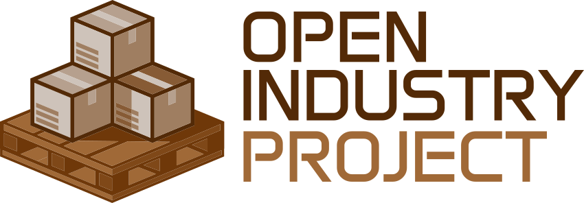
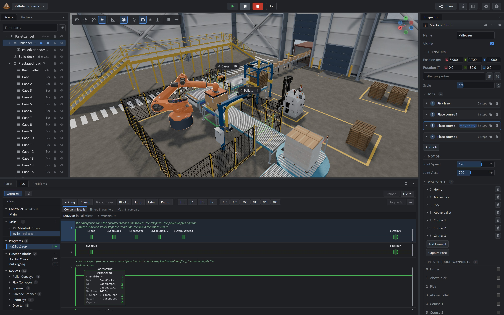

<picture>
  <source media="(prefers-color-scheme: dark)" srcset=".github/OIP-LOGO-RGB_HORIZONTAL-INV.svg">
  <source media="(prefers-color-scheme: light)" srcset=".github/OIP-LOGO-RGB_HORIZONTAL.svg">
  
</picture>

[](LICENSE)
[](https://discord.gg/ACRPr6sBpH)

Free and open-source warehouse/manufacturing simulator that runs in the browser.

The goal is to provide an open platform for people to test their ideas or educate themselves
using standard industrial equipment and PLC languages. It includes its own PLC, so no hardware
or PLC software is needed to get started.

[](https://www.openindustryproject.org/app/?scene=demo)

The editor runs at [openindustryproject.org/app](https://www.openindustryproject.org/app/?scene=demo),
which opens a demo palletizing line.

A desktop app is needed to connect to an external PLC:

- Windows: signed [installer](https://downloads.openindustryproject.org/desktop/Open-Industry-Project-Setup.exe)
- Linux: [.deb](https://downloads.openindustryproject.org/desktop/open-industry-project_amd64.deb) (Ubuntu, Debian)
  or [AppImage](https://downloads.openindustryproject.org/desktop/Open-Industry-Project.AppImage) (needs libfuse2)

## Project Status

The project is in early development, and breaking changes can land in any update. In particular:

- **Projects and scenes.** Saved projects, `.oip` files and live-editing rooms are upgraded when
  they load wherever possible, but that isn't guaranteed. Keep a copy of any project you care about.
- **The [part SDK](packages/part-sdk/).** The behavior API and the manifest format can change, and a
  custom part may need edits to keep working.
- **The PLC engine.** How a program parses, runs and exports is still being checked against other
  IEC 61131-3 implementations, so a program's behavior can change as bugs are found and fixed.

If an update breaks something of yours, please [open an issue](https://github.com/Open-Industry-Project/Open-Industry-Project/issues)
or tell us on [Discord](https://discord.gg/ACRPr6sBpH).

## Features

- Conveyors, sensors, diverters, robots, AGVs and more, with snapping between parts
- Built-in PLC (a subset of IEC 61131-3 Structured Text and Ladder Diagram)
- Program import/export: ST, PLCopen XML (ladder included)
- Connect to external PLCs over Modbus TCP, OPC UA, EtherNet/IP (Logix), S7 PUT/GET
  (S7-1200/1500), SLMP (MELSEC) or ADS (TwinCAT) (desktop app; see the
  [connection guides](https://www.openindustryproject.org/guides/))
- OPC UA server, so a SCADA or HMI can read the simulation (desktop app)
- Custom parts via the [part SDK](packages/part-sdk/)
- Live collaboration

## Running Locally

Node 24 or newer is required.

```sh
npm ci
npm run dev     # landing page at /, editor at /app/
npm test
```

See [CONTRIBUTING.md](CONTRIBUTING.md) for the checks to run before opening a PR and the
conventions used in the code. [docs/technical-overview.md](docs/technical-overview.md) covers the
scene format, physics, parts and command-line tools, and [docs/](docs/README.md) indexes the rest
of the design notes.

## Help Wanted

Contributions are welcome! Check the [open issues](https://github.com/Open-Industry-Project/Open-Industry-Project/issues) for tasks to pick up, or help with any of the following:

- Additional equipment and device models
- Testing with PLCs and hardware
- Documentation and tutorials
- PLC instruction coverage

Join us on [Discord](https://discord.gg/ACRPr6sBpH) to discuss ideas or ask questions.

## License

This project is licensed under the [MIT License](LICENSE). Third-party assets and libraries
are credited in [THIRD_PARTY_NOTICES.md](THIRD_PARTY_NOTICES.md).

Product names are trademarks of their owners, named here only to identify them; see
[THIRD_PARTY_NOTICES.md](THIRD_PARTY_NOTICES.md#trademarks). The Open Industry Project is not affiliated with
or endorsed by them.
